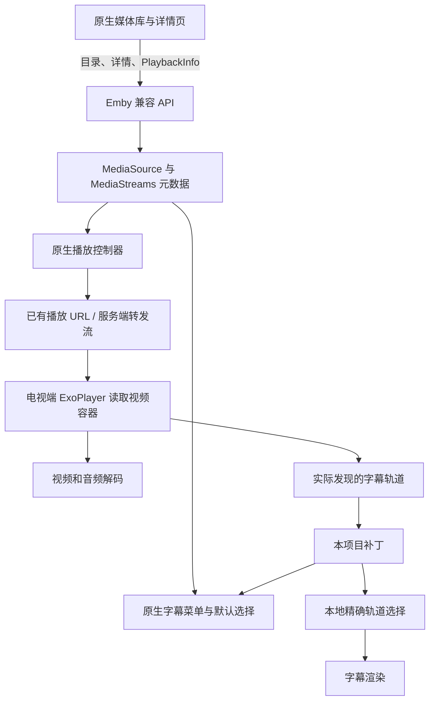

# Emby 安卓电视字幕补丁：完整项目报告

> 记录日期：2026-10-30。本文描述实际完成的工作、代码实现、验证结果和仍未解决的边界。公开版本已去除用户账号、密码、访问令牌、服务器地址、设备地址、签名私钥及原始聊天记录。

## 阅读导航

- 想了解“为什么视频能播，字幕却没有”：第 2—4 节。
- 想了解“具体改了哪些代码”：第 5—8 节及 [ARCHITECTURE.md](ARCHITECTURE.md)。
- 想自己构建和安装：[BUILD.md](BUILD.md)。
- 想核对“到底测过什么”：第 9 节及 [TESTING.md](TESTING.md)。
- 想继续开发：第 12—14 节，以及仓库根目录 [AGENTS.md](../AGENTS.md)。

## 1. 最终结果与交付范围

我们制作并安装了一个独立包名的 **Emby 字幕测试版**，保留原生电视客户端的媒体库、详情页和播放界面。在实际视频包含字幕、但服务器没有完整登记这些字幕的情况下，客户端可以读取播放器已发现的轨道，将它们加入字幕菜单，并自动选择中文字幕；简体优先，没有中文时回退英文。用户仍可手动选择其他字幕或关闭字幕。

测试后，用户亲自在电视上验证，并反馈可以正常工作。随后按用户要求卸载了另外两个 Emby 客户端和 Kodi，保留可用版本。最后更新了电视桌面横幅：绿色播放标志、Emby 字标及 `free subtitle` 标签。

本仓库交付的是 **补丁工程的完整源码**，包括 Java 辅助实现、Smali 注入脚本、构建脚本、主机测试、合成测试夹具、横幅资源和技术文档。它不是 Emby 官方完整源码，也不包含原版或重打包 APK。构建者必须自行提供准确匹配的原版 APK 和本地签名材料。

不能把上述结果扩展为“所有影片、所有电视、所有字幕格式已经验证”。尤其是任意拖动进度、某些转码后的重建路径和全片字幕同步，尚未完成全面验证。

## 2. 使用场景、原始需求与约束

### 2.1 用户看到的问题

电视已经能够连接远程媒体库，海报和影片列表可以加载，视频也能播放。但是：

1. 新打开的影片经常没有自动出现字幕。
2. 有些影片详情页可选视频版本、音轨和字幕，有些只显示视频版本，有些全部不显示。
3. 用户曾手动让个别影片显示字幕，因此问题不是简单的“整台电视不支持字幕”。
4. 账号字幕偏好已经设置为中文、始终显示，现象仍然存在。
5. 用户希望保留好用的原生界面，不愿长期依赖已试过但不喜欢的 Kodi 界面。

### 2.2 最终明确的产品要求

- 能播放已有媒体库中的视频。
- 能继续浏览原有媒体库，不重新制作一套片库界面。
- 优先选择中文字幕，能够识别时偏好简体。
- 没有中文字幕时，自动尝试英文字幕。
- 在播放前**或**播放期间提供手动切换入口，并尊重关闭操作。
- 不依赖服务端管理员权限。
- 调试时使用 2000 年之后的欧美电影随机候选，不使用《哈利波特》系列。
- 保持已工作的版本与数据，避免测试覆盖正式安装。

### 2.3 技术约束

| 项目 | 本次情况 |
|---|---|
| 电视 | 海信/VIDAA，Android 11 |
| 修改目标 | Emby for Android TV 2.5.03g |
| 片库入口 | Emby 兼容 API 提供目录、元数据、播放信息和进度 |
| 部分片源 | STRM 指向远程视频文件；元数据可能没有登记媒体轨道 |
| 权限 | 没有可依赖的服务端管理权限 |
| 原代码获取 | 分析指定已发布 APK 的结构；新增补丁代码由本项目实现 |
| 测试安装 | 使用独立包名，不覆盖官方包身份 |

“服务器只是网盘”与“客户端通过 Emby API 工作”并不矛盾：底层文件可以存放在网盘或其他存储，但客户端仍需要一个目录/鉴权/播放信息服务。问题排查必须区分这些层次，不能把存储、API 服务和电视播放器当作同一个东西。

## 3. 实际数据流，以及为什么画面和字幕会不同步成功



### 3.1 STRM 不是视频容器

STRM 通常是保存播放位置的文本入口。它能让服务器知道“这个影片到哪里播放”，但不保证服务器已经探测该目标文件的所有音轨和字幕。

因此，可以同时发生：

- 服务器能够给出一个可播放的视频地址；
- 服务器的 `MediaStreams` 中没有字幕；
- 电视播放器读到远程 MKV 后，却能发现里面的字幕。

这不是所有 STRM 都必然有的问题。是否缺元数据取决于服务端扫描、探测、远程链接和缓存等情况。本项目针对的是已经观察到的元数据不完整场景。

### 3.2 详情页选择器缺失有两类原因

一种是 UI 条件：原生详情页是否显示版本和预播放选择器，受版本数量及相应设置影响。另一种更关键：即使选择器容器出现，如果服务端没有字幕条目，依然没有字幕选项可供显示。

只打开“显示预播放媒体选择”并不能凭空补出字幕信息。因此，早期把问题完全归因于这个开关是不完整的解释。

### 3.3 “有字幕轨”“选中了轨”“画面出现字幕”是三件事

排查必须逐层验证：

1. 容器或播放器里是否真的有字幕轨。
2. 该轨是否被标记为支持，能否进入菜单。
3. 默认或手动选择是否指向正确的播放器轨道。
4. 解码器是否产生文字/位图 cue。
5. 这些 cue 是否真正显示在电视画面上。

菜单勾选、语言标签、日志中的选中索引，都不能单独证明字幕已经显示。尤其是只包含片头文字、路牌或外语片段的字幕，可能长时间没有对白字幕。

## 4. 排查过程与方案演变

### 阶段 A：检查账号、详情页与服务端元数据

先对比有字幕和无字幕的影片，检查字幕偏好、版本数量、详情页选择器和 `MediaStreams`。发现一些问题影片可以播放，但元数据中的音轨/字幕列表为空。这说明继续重复修改账号默认语言不能解决全部问题。

### 阶段 B：确认字幕实际存在

利用能够读取播放流的探测工具，确认部分视频内部确实包含 ASS、SRT 或 PGS 中文字幕。这里需要可达的实际播放路径；直接使用服务端所在私网的地址，不一定能从电视所在网络访问。

由此将问题从“缺少字幕文件”缩小为“客户端没有正确暴露和选择视频里的字幕”。探测结果并不意味着所有影片都有字幕，也不意味着某个字幕轨一定覆盖全片对白。

### 阶段 C：尝试 Kodi 与插件

曾尝试 Kodi 加 Emby 插件，使播放器自行读取流中的轨道。过程中遇到直接播放地址指向不可达私网地址的问题，并探索通过已有服务端转发播放。

这条路线也暴露了使用体验问题：用户不喜欢 Kodi 的界面，希望继续使用原生 Emby 媒体库。最终选择修改原生客户端的字幕发现/选择链路，而不是持续增加 Kodi 专用配置。

本仓库不包含早期带账号的插件包、代理试验脚本、服务地址或相关聊天导出。它们不是最终补丁的构建依赖。

### 阶段 D：原生补丁、静态审查与独立测试

先在独立包名中实现播放器轨道发现，再通过 REA/JADX 检查原生控制器、播放器、字幕菜单和详情页的实际调用关系。静态审查找出索引泄漏、生命周期、重复注入和手动状态等风险；随后结合主机测试与电视实测修复。

Opus 5.5 的职责是静态审查和有依据的代码修改，未执行测试或 ADB 操作。实际测试、构建、签名、安装和后续修正由 Codex 完成。一次后续分析超时，之后只基于已有证据完成报告。不能把静态审查报告中的“建议”当作已在设备上验证的事实。

### 阶段 E：用户验收、清理与品牌资源更新

用户反馈可用后，才按明确要求卸载旧客户端和 Kodi。新横幅通过更新安装应用，未清除应用数据。资源更新后对 APK 条目逐项比较：非签名内容只有横幅 PNG 改变，所有 DEX 字节一致，并在电视桌面看到了新标签。

## 5. 已识别问题与修复对照

| 编号 | 触发条件 / 现象 | 根因与证据 | 最终处理 |
|---|---|---|---|
| P01 | 画面能播，元数据无字幕，菜单为空 | 原菜单依赖服务端条目，而播放器有额外字幕轨 | 在已有 READY 时机发现播放器文本轨，补入原生菜单与可见性标记 |
| P02 | 默认语言已设置，首次播放仍无中文 | 默认流程未覆盖播放器新增轨；服务端默认值可能被误当手动选择 | 自动策略统一评估候选，实际手动操作另行记录 |
| P03 | 重播或内部重启后出现无效字幕索引 | 旧选择器、列表及合成索引可能仍被使用 | 重取当前选择器，校验列表身份和实际轨道，清理过期默认值 |
| P04 | 本地新增编号可能进入服务端播放请求 | 原方法在验证前就写入请求选项 | 所有 `>=10000` 索引由补丁消费；有效本地选择后清空服务端字幕状态 |
| P05 | 服务端已列出的字幕与本地发现重复 | 无条件附加播放器轨道；外挂也被当作内嵌再次枚举 | 仅在播放器内嵌轨数更多时暴露；排除外部合并子源 |
| P06 | 用户关闭/切换后又被自动选择覆盖 | 每次准备播放都重新执行默认策略 | 记录当前控制器/影片的手动状态，区别自动回调与菜单操作 |
| P07 | 播放前选择英文或关闭没有正确延续 | 初始化回调与用户点击混淆；原意图遗漏负数 Off | 捕获明确的弹出菜单行点击；用一次性、按影片/片源匹配的记忆传递 |
| P08 | PGS 在视频里但不被列为可播放 | 原工厂可创建 PGS 解码器，却在 supportsFormat 中漏掉 MIME | 补上支持声明，使用现有解码器 |
| P09 | 选择外挂繁体，实际选中内嵌英文 | 服务端字幕编号被当成播放器内部序号 | 根据合并子源构造顺序定位外部字幕的实际 child/group |
| P10 | 同时存在多个文本渲染器时选择不可靠 | 单独覆盖某轨而未清理其他文本渲染器状态 | 仅启用目标文本渲染器，清除其他相关覆盖 |
| P11 | 再次运行补丁脚本出现重复注入 | 插入逻辑不识别已有钩子 | 精确检测已注入形式；未知方法结构直接失败 |
| P12 | 独立测试包可能与官方包身份冲突 | 全局 permission/provider authority 和常量仍指向旧身份 | 修改包名、权限声明、authority 及关联常量，保留原实现类名 |
| P13 | 图标不易辨认、多个客户端易混淆 | 原图标及多版本并存造成使用混乱 | 验收后清理旧应用，使用经用户确认的 TV 横幅 |

以上不是每项都由一次真实设备崩溃触发。P03、P04、P10 等包含静态审查发现的风险和针对性主机回归验证。P08、P09 则有实际影片场景支持。详细证据分层见 [TESTING.md](TESTING.md)。

## 6. 代码是什么：文件、职责与调用关系

| 文件 | 作用 | 为什么这样拆分 |
|---|---|---|
| `src/local/emby/subtitles/Selector.java` | 识别语言、简繁标签和 forced/dub 特征，给字幕评分 | 纯算法可脱离 Android 单独测试 |
| `src/local/emby/subtitles/Policy.java` | 自动策略、手动选择、索引范围和候选模型 | 把“选什么”与“如何控制播放器”分离 |
| `src/local/emby/subtitles/Bridge.java` | 反射访问原生对象、发现轨道、维护状态、精确选择、外挂映射 | 不编译依赖私有 Emby SDK；但明确绑定此 APK 结构 |
| `src/local/emby/subtitles/Diagnostics.java` | 可选的字幕 cue 数量/位图数量诊断 | 区分“已经选择”与“确实进入字幕视图” |
| `patch.py` | 向指定 Smali 方法和 manifest 注入钩子 | 把二进制补丁流程变成可重复执行的源码操作 |
| `build.sh` | 摘要校验、干净解包、编译、注入 DEX、对齐、签名、验签 | 避免依赖已被修改的临时目录 |
| `tests/` | 算法、状态、桥接和注入回归 | 无账号、无服务器、无电视也可运行 |
| `tests/fixtures/` | 最小手写 Smali 结构夹具 | 公开仓库不携带完整反编译类；只测试注入契约 |
| `branding/app_icon.png` | 最终批准的电视横幅 | 作为构建输入，防止下次构建恢复旧图 |

### 6.1 不是重写视频提取器

用户最初将需求表述为“从视频文件提取字幕”。最终实现更准确的描述是：**使用原播放器已经发现的内嵌字幕轨道，并将它们暴露给菜单、自动策略和精确选择器**。

没有新增整片下载，没有将字幕批量导出为独立 SRT，也没有添加字幕搜索网站、翻译模型或语音识别服务。因此无需额外账号，也不增加这类服务的依赖。

### 6.2 不修改服务器的原因

用户没有可依赖的服务端管理权限。修改服务器探测、刷新整库或为每部影片上传外挂字幕，都会超出这个约束。客户端补丁将修复放在用户可控制的层次，同时保留服务端已经正确提供的条目和原有播放流程。

## 7. 字幕选择规则与重要边界

### 7.1 自动选择顺序

总体目标为“中文优先、简体偏好、英文回退”。实现使用评分而非仅按数组顺序：中文基础分高于英文；简体加分；forced 字幕降低优先级；音频为非中文时，明显按国语/粤语配音制作的字幕也降低优先级。

这意味着“完整繁体”可以优先于“仅少量强制简体”，符合实际观看需要。标签不能完全反映字幕内容时，仍可能选中稀疏轨道，用户可以手动切换。没有可识别中文或英文时保留原默认，不擅自猜测其他语言。

### 7.2 三种编号必须区分

- 服务端编号：服务端理解的字幕轨道。
- 播放器位置：renderer/group/track 三元组。
- 本地菜单编号：从 10000 开始，仅供补丁识别。

将三者混用会导致“菜单选择中文，实际播英文”，甚至把服务端不认识的数字发送回去。索引隔离和当前轨道重新验证是本项目最重要的实现约束之一。

### 7.3 播放前与播放中并不完全对等

如果服务端已列出字幕，原生详情页可以提供播放前选择，补丁负责保留用户的明确选择，包括 Off。

如果服务端没有字幕元数据，详情页仍不知道实际轨道。补丁要等播放器读到文件后才能发现，因此在播放中提供选择。这满足“播放前或播放期间”的需求，但不声称在所有影片开播前都能列出完整字幕清单。

### 7.4 手动状态不是永久账号偏好

播放中的选择保存在当前控制器/影片的内存状态中。播放前选择额外按片源匹配，一次性消费，并在 10 分钟后过期。它们都不是写回账号的永久逐片字幕设置；杀死进程后也不保证保留。

## 8. PGS 与外挂字幕：两个容易被忽略的独立问题

### 8.1 PGS 问题不等于“电视没有解码器”

检查指定 APK 后发现，解码器工厂已经包含 PGS 创建路径，但格式支持判断漏掉 `application/pgs`。因此播放器把它视为不支持，补丁的常规发现逻辑也不能选择它。

修复只是让支持判断认可已存在的解码器，并为菜单使用原生 `pgssub` 格式名。实际测试看到位图 cue 进入 SubtitleView 并显示到屏幕，才确认这一链路有效。

另一个支持值 `7` 也被纳入可用范围，但它只是代码审查发现的兼容遗漏；不能把它描述成这次真实 PGS 故障的唯一根因。

### 8.2 外挂编号为什么会偏移

《比邻星》的服务端列出简体、繁体两条外部字幕，但视频内部还有英文字幕。原播放器把外部文件合并到视频媒体源后，内部排序不再等于服务端编号。

修复重新按照原构建顺序统计有效外部字幕源，将所选服务端条目映射到真正的合并 child/group。只有结构和数量一致时应用修正，否则保留原流程。这个判断避免在未知布局上盲目选择，但也意味着无法保证所有未见过的合并格式都已支持。

## 9. 验证结果：哪些是真实通过，哪些尚未完成

### 9.1 自动化验证

最终发布用源码运行结果：

- Selector：19 项断言。
- Policy：15 项断言。
- Bridge：37 项断言。
- Python 补丁注入：6 项测试。

这些是单元/结构测试，不是 77 部电影或 77 次设备实播。主机测试使用手写假的控制器、选择器和模型对象，验证决策和字段写入，不具备 Android 的解码与渲染能力。

发布整理时，将私有反编译参考夹具换成最小手写结构夹具，并重新运行测试。真实 APK 兼容性仍依赖固定摘要、Smali 结构检查、实际构建和设备验证，而不是这些夹具本身。

### 9.2 影片实测

| 影片 | 年份 / 场景 | 实际结果 |
|---|---|---|
| 《湮灭》Annihilation | 2018，服务端无字幕轨元数据 | 早期版本自动简体 ASS、手动繁体及关闭通过；最终版本冷启动发现 7 条字幕，自动简体 PGS，出现中文片头翻译 |
| 《阿尔忒弥斯酒店》Hotel Artemis | 2018，无中文、含英文/德文 PGS | 自动选英文，并看到地点/日期的英文位图翻译；不能证明该轨包含全部对白 |
| 《比邻星》Proxima | 2019，外挂中文加内嵌英文 | 重现并修复外挂索引错位；播放前选繁体后实际显示繁体；播放前 Off 在播放中保持关闭 |
| 《欢喜冤家》The Hating Game | 2021，随机候选 | 探测失败，不计入通过项 |

测试来自指定类型与年份的随机候选，而不是随便打开历史播放页面。曾误回旧详情页的排除影片结果未用于验收，之后重置页面栈并设置允许列表。

### 9.3 用户验收与安装包验证

用户亲自操作电视后反馈工作正常。这是有价值的用户验收，但不能替代特定边界场景的测试。

对最终安装包进行了签名验证、校验和比对；横幅更新额外确认 DEX 不变，仅图片资源变化。公开源码目录也重新完成了完整构建：DEX 与已安装版本逐字节相同；横幅像素一致，PNG 文件字节因 aapt 重新打包而不同。该复核构建没有再次安装到电视。部署标识摘要保存在 [ARTIFACTS.json](ARTIFACTS.json)，不包含设备或账号信息。使用者用不同签名密钥重建时，APK 摘要自然会不同。

### 9.4 未完成覆盖

- 任意拖动进度，尤其转码 MKV/TS 的媒体源替换路径。
- 最终版本额外的暂停/继续循环；交还遥控器后没有继续远程测试。
- 全片字幕时间轴与对白覆盖、所有 ASS 特效/字体、所有 PGS 变体。
- 所有媒体版本切换以及同影片不同片源上的手动状态继承。
- 对全媒体库、其他电视、其他 APK 版本、其他服务端的普遍兼容性。
- 完整的网络抓包证明：本地索引隔离已由静态路径和状态测试支持，但未宣称抓取过所有网络请求。

## 10. 新图标与应用清理做了什么

用户要求新横幅简洁、容易在电视远处辨识。先生成深色背景、绿色播放标志与 Emby 字标，再按用户要求添加小字 `free subtitle`。

最终修改的是 Android TV 横幅资源 `res/drawable/app_icon.png`。显示名称仍是“Emby 字幕测试版”，方形系统图标未改。桌面使用这个横幅后，实际能看到新标签。

为了最大限度保留已验证功能，横幅部署没有重写或重新调试播放器代码：直接对已接受的安装包做资源更新、重新签名，再用更新安装保留数据。随后将同一图片纳入干净构建脚本，保证后续从源码构建也会带上新横幅。

`free subtitle` 只是用户指定的视觉标签，不代表绕过付费验证，也不意味着客户端能凭空获取不存在的字幕。

用户确认修复可用后，按其明确要求删除两个旧 Emby 安装和 Kodi。这个清理操作与补丁功能没有依赖关系；其他使用者可以保留官方客户端。

## 11. 凭据与公开仓库边界

公开仓库从白名单文件构建，不是把整个工作目录直接上传。特意排除：

- Emby 用户名、密码、访问令牌、已登录配置和服务器 URL。
- 电视 IP、家庭网络拓扑、Wi-Fi 名称、设备会话与片库条目 ID。
- 签名私钥、口令、开发者本地配置与原始 APK。
- 带认证信息的临时脚本、插件包、调试 API 输出和原始 logcat。
- 全量反编译源码、原始模型审查会话、聊天记录和未脱敏截图。

例如，桌面截图虽然没有密码，也可能出现 Wi-Fi SSID，因此未直接加入公开仓库。报告使用脱敏结果与可复现方法替代私人截图。发布前进行文本检查、凭据扫描和 Git 跟踪文件检查；扫描工具不能提供绝对无遗漏保证，后续提交仍需遵循同样边界。

## 12. 如何复现、构建与继续排查

完整命令见 [BUILD.md](BUILD.md)。最短开发入口是：

```sh
sh tests/run_host_tests.sh
```

这个测试入口不需要账号、APK、服务器或电视。真实构建则必须提供匹配摘要的原 APK、JDK、Android 工具链、Apktool 和自己的签名密钥。测试假类不得编译进 APK。

新接手的开发者应按以下顺序工作：

1. 阅读 README、本文、架构、测试记录和构建说明。
2. 确认目标 APK 是否与固定摘要一致；不同版本先重新分析，不直接解除检查。
3. 复现具体失败，并区分“元数据无轨”“播放器未发现”“不支持格式”“选错轨”“cue 未渲染”。
4. 先用纯算法/桥接测试覆盖可模拟部分，再在单独授权的设备做实播。
5. 检查本地菜单编号没有进入服务端播放选项。
6. 每次报告明确写明观察、推断和未验证项；不要把主机测试成功包装成设备成功。
7. 分享日志前去除路径、URL、令牌、账号、设备及片库标识。

## 13. 后续改进优先级

本节是已知后续方向，不代表本次已经实现或授权部署。

1. **转码 seek 生命周期。** 找出新媒体源、轨道组与菜单标记的更新点，构造真实可 seek 的样本，验证本地选择在 seek 后保持正确。
2. **部分元数据的精确去重。** 当前是数量启发式；可以研究按语言、格式、标签和可追溯索引做更可靠匹配。
3. **同影片切换版本的手动状态。** 播放前状态已有片源约束，播放中状态仍需更完整的同片不同源测试。
4. **反射契约自动检查。** 对新 APK 建立独立静态验证，明确哪些私有字段/方法发生变化。
5. **更多格式与设备。** 在不改变已通过版本的前提下，补足 ASS 样式、PGS、多渲染器和外部文件格式测试。
6. **诊断最小化。** 正式维护版本可考虑让详细轨道日志也可配置，并对异常消息做隐私约束。

## 14. 给其他代理的交接说明

- 已工作的播放器补丁不是待重新设计的草案。不要因为整理文档就重写运行逻辑。
- 不要要求用户重新提供曾经用过的密码；公开工程不需要真实凭据才能运行主机测试。
- 不要把官方 Emby 应用叫作本项目开源代码；这里公开的是自编补丁及测试。
- 不要对没有中文字幕的文件承诺显示中文；不包含字幕搜索、翻译或自动生成。
- 不要将 `10000+` 本地编号用作服务端索引。
- 不要把重复构建等同于跨环境签名 APK 的逐字节一致。
- 不要再委派 Opus；用户已经说明其额度限制。
- 任何“完成”声明都应对应到具体文件、命令结果或设备观察。

项目经历的关键转变是：从依赖服务器预先登记字幕，转为利用客户端播放器真实发现的轨道，同时补齐原生 UI、默认策略和索引隔离。最终效果保留了用户希望使用的原生界面，也保留了明确的可验证边界。
